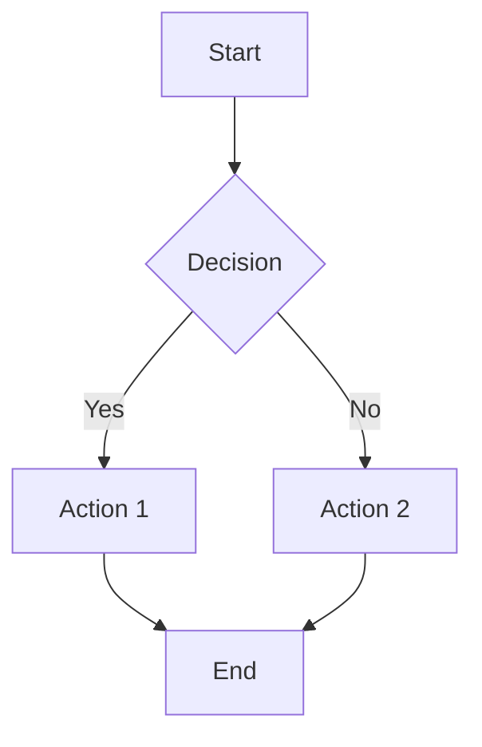

k# Markdown Syntax Guide

> This is a blockquote. Blockquotes can span multiple lines and contain other elements.
>
> > Nested blockquotes are also supported.

---

## Headings

# Heading 1
## Heading 2
### Heading 3
#### Heading 4
##### Heading 5
###### Heading 6

---

## Paragraphs and Text Formatting

This is a normal paragraph. Lorem ipsum dolor sit amet, consectetur adipiscing elit. Sed do eiusmod tempor incididunt ut labore et dolore magna aliqua.

This is a paragraph with **bold text**, *italic text*, and ***bold and italic text***.

You can also use __underscores__ for _italic_ and ___bold italic___.

This text has ~~strikethrough~~ applied to it.

This is an example of `inline code` within a paragraph.

Superscript: x^2^ and Subscript: H~2~O (GitHub Flavored Markdown may vary in support).

This text is ==highlighted== (may vary by renderer).

---

## Links

Here is a [basic link](https://www.example.com).

Here is a [link with title](https://www.example.com "Example Title").

Here is a bare URL: <https://www.example.com>.

Here is an email address: <address@example.com>.

Reference-style links are also supported: [Reference Link][ref1].

[ref1]: https://www.example.com "Reference Example"

---

## Lists

### Unordered Lists

- Item 1
- Item 2
  - Nested Item 2.1
  - Nested Item 2.2
    - Deeply Nested Item 2.2.1
- Item 3

* Also asterisks work
* For unordered lists

+ Plus signs too
+ Are valid

### Ordered Lists

1. First item
2. Second item
   1. Nested ordered item 2.1
   2. Nested ordered item 2.2
3. Third item

### Task Lists

- [x] Completed task
- [ ] Incomplete task
- [ ] Another incomplete task

---

## Code Blocks

### Fenced Code Blocks

```ruby
# Ruby code example
def hello_world
  puts "Hello, World!"
end
```

```javascript
// JavaScript code example
function helloWorld() {
  console.log("Hello, World!");
}
```

```python
# Python code example
def hello_world():
    print("Hello, World!")
```

```
Generic code block without language specification.
```

### Indented Code Blocks

    This is an indented code block.
    It uses four spaces or a tab.

---

## Horizontal Rules

Three hyphens:

---

Three asterisks:

***

Three underscores:

___

---

## Tables

| Header 1 | Header 2 | Header 3 |
|----------|----------|----------|
| Row 1 Col 1 | Row 1 Col 2 | Row 1 Col 3 |
| Row 2 Col 1 | Row 2 Col 2 | Row 2 Col 3 |
| Left | Center | Right |
| Aligned | Aligned | Aligned |

Alignment table:

| Left Aligned | Center Aligned | Right Aligned |
|:-------------|:--------------:|--------------:|
| Cell 1       | Cell 2         | Cell 3        |
| Longer Text  | More Text      | Short         |

---

## Definition Lists

Term 1
: Definition for term 1. This can span multiple lines.

Term 2
: Definition for term 2.
: Another definition for term 2.

---

## Footnotes

Here is some text with a footnote reference[^1].

[^1]: This is the footnote content.

Here is another footnote[^longnote] with a longer label.

[^longnote]: This is a longer footnote that can contain multiple paragraphs.

    Subsequent paragraphs are indented.

---

## Abbreviations

The HTML specification is maintained by the W3C.

*[HTML]: Hyper Text Markup Language
*[W3C]: World Wide Web Consortium

---

## HTML Elements

Some Markdown renderers allow raw HTML:

<div align="center">
  <p>This is a centered paragraph using HTML.</p>
</div>

<details>
<summary>Click to expand</summary>

This is hidden content inside a details element.

</details>

---

## Emojis (Shortcodes)

:smile: :heart: :thumbsup: :rocket:

---

## Escaping Characters

Here are some characters that usually have special meaning in Markdown, but are escaped:

\*asterisks\*
\_underscores\_
\`backticks\`
\# hash
\[brackets\]
\{braces\}
\(parentheses\)
\! exclamation
\+ plus
\- minus
\. dot
\| pipe

---

## Mathematical Expressions (LaTeX/MathJax)

Inline math: $E = mc^2$

Block math:

$$
\sum_{i=1}^{n} x_i = x_1 + x_2 + \dots + x_n
$$

---

## Diagrams (Mermaid - if supported)



---

## Mixed Content Examples

> ### Heading Inside Blockquote
>
> - List item 1 in blockquote
> - List item 2 in blockquote
>
> ```
> Code block inside blockquote
> ```

- List item with **bold text** and [a link](https://example.com)
- List item with `inline code`
- List item with a blockquote:
  > Nested blockquote inside list item

1. Ordered item with a table:

   | A | B |
   |---|---|
   | 1 | 2 |

2. Ordered item with a code block:

   ```python
   print("Hello from list")
   ```

---

## Line Breaks and Paragraphs

This is the first line.  
This is the second line with a hard break (two trailing spaces).

This is a new paragraph after a blank line.

This line ends with a backslash for a hard break\
and continues here.

---

## Comments

<!-- This is an HTML comment that is hidden in the rendered output -->

[//]: # (This is another type of comment)

<!--- This is also a comment --->

---

End of sample document.
